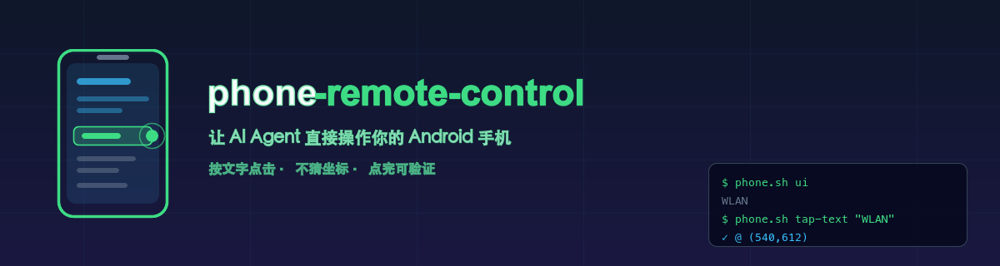
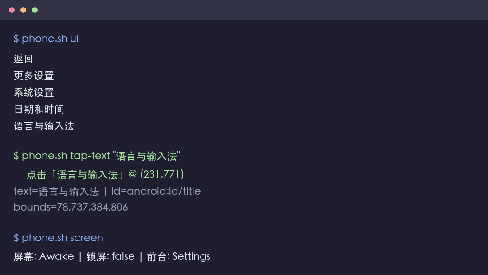
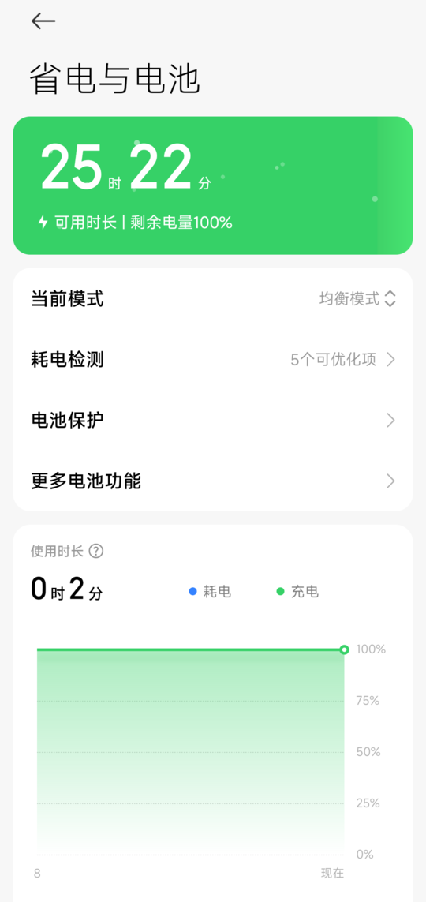
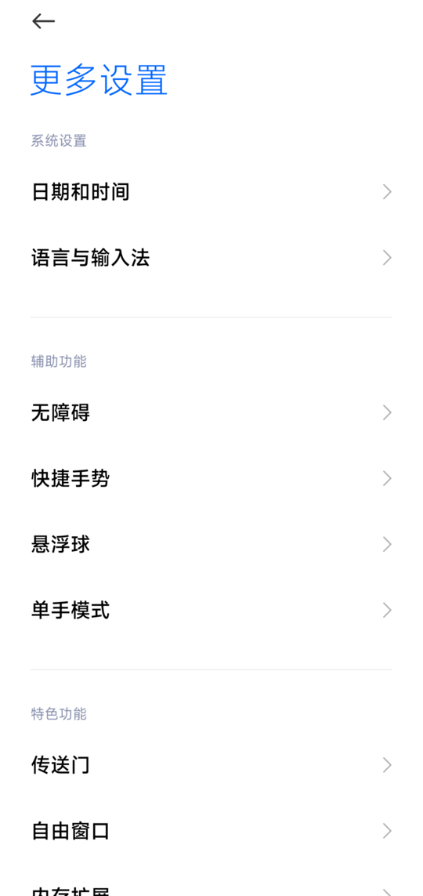
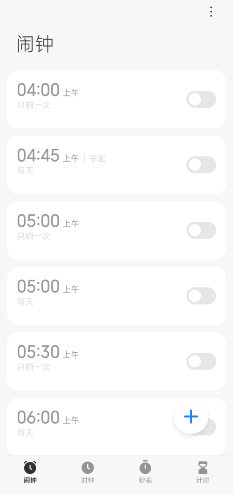

<div align="center">



# phone-remote-control

**让你自己的 AI Agent 直接操作你的 Android 手机。**

不用数据线、不用公网 IP、不用 root。一条命令，手机变成 Agent 可以读、可以点的界面。

[](https://github.com/zibochen6/phone-remote-control/actions/workflows/ci.yml)
[](LICENSE)
[](#环境要求)
[](#环境要求)
[](CONTRIBUTING.md)
[](#)

[快速开始](#30-秒上手) · [原理](#为什么不用-scrcpy--appium--uiautomator) · [命令](#命令速查) · [应用案例](docs/use-cases.md) · [FAQ](#faq) · [English](README.en.md)

</div>

---

## 这是什么

一个 shell 脚本 + 一个 Agent Skill，把 Android 手机的界面变成**结构化、可验证**的操作目标。

```bash
phone.sh ui                        # 读出屏幕上有什么
phone.sh tap-text "WLAN"           # 按文字点击，不猜坐标
phone.sh wait-text "已连接" 15      # 确认这一步真的生效了
```

**它解决的核心问题：** 让 Agent 操作手机时，**不再靠坐标盲点**。

坐标会因为分辨率、字体大小、系统语言、系统版本变化而失效 ——
你在 1080p 上调好的脚本，换台手机就全错位了。
而文字不会：`tap-text` 会去读系统的控件树，找到那个词，点它的真实位置。

<div align="center">
  
</div>

---

## 为什么不用 scrcpy / Appium / UiAutomator

它们都是好工具，但目标不同。这个项目**不是**它们的替代品：

| | **本项目** | scrcpy | Appium | 纯 UiAutomator |
| --- | --- | --- | --- | --- |
| 定位 | 给 Agent / 脚本用的操作层 | 人工投屏鼠标操作 | 专业 UI 测试框架 | 底层测试 API |
| 按文字点击 | ✅ 内置 `tap-text` | ❌ 只能鼠标拖 | ✅ 需写定位器 | ⚠️ 要自己写 |
| 点完能验证 | ✅ `wait-text` | ❌ 靠人眼看 | ✅ | ⚠️ 要自己写 |
| 装完就能用 | ✅ 一个脚本 | ✅ | ❌ 要起 Server + 客户端 + 驱动 | ❌ 要写 Java + 编译 |
| 依赖 | adb（+python3） | adb | Node/Java + Appium Server | Android SDK |
| 学习成本 | 看 10 行命令 | 很低 | 高 | 高 |
| 适合 Agent 调用 | ✅ 纯 CLI，输出可解析 | ❌ GUI 程序 | ⚠️ 需封装 | ❌ 需封装 |

**一句话：** 想让 AI 或脚本「点一下手机上的这个按钮并确认成功」，
这个项目是专门为这件事设计的。想人肉玩手机，用 scrcpy。

---

## 30 秒上手

### 第一步：装依赖

```bash
# macOS
brew install --cask android-platform-tools && brew install python3

# Ubuntu / Debian
sudo apt install android-tools-adb python3
```

### 第二步：让手机允许被操作

**Android 11+（推荐，不用线）**

1. 设置 → 关于手机 → 连点「版本号」7 次
2. 设置 → 系统 → 开发者选项 → 打开 **无线调试**
3. 点「使用配对码配对设备」，**停在那个弹框上别关**

**Android 10 及以下（用数据线）**

1. 同上开启开发者选项，打开 **USB 调试**
2. 插数据线，手机通知栏选 **传输文件**
3. 手机上弹「允许 USB 调试吗」→ 勾选「一律允许」→ 允许

### 第三步：连上

```bash
phone.sh pair        # 无线调试（推荐）
# 或
phone.sh setup       # 自动检测并告诉你下一步
```

### 第四步：验证

```bash
phone.sh status      # 一次看全：工具/设备/屏幕/前台
phone.sh screen      # 屏幕状态
```

看到 `✓ 已连接` 就成了。

<div align="center">
  
  
  
  <br/>
  <sub>↑ 这些图全部由本项目自身截图并自动脱敏生成</sub>
</div>

> **完整图文教程**（每一步都有说明，专门写给第一次接触的人）：
> [无线调试](skills/phone-remote-control/references/setup-wireless.md) ·
> [USB 数据线](skills/phone-remote-control/references/setup-usb.md) ·
> [异地控制](skills/phone-remote-control/references/setup-tailscale.md)

---

## 三种接入方式，选一个

| | 无线调试 | USB 数据线 | Tailscale |
| --- | --- | --- | --- |
| **适用** | Android 11+ | 全部机型 | 手机不在同一网络 |
| **需要线** | ❌ | ✅ | 只需一次 |
| **需要装 App** | ❌ | ❌ | 手机和电脑各装一个 |
| **跨网络** | ❌ 同一 Wi-Fi | ❌ | ✅ 4G 也能连 |
| **重启后** | 要重开再配对 | 重插即可 | 要插一次线恢复端口 |
| **教程** | [看这里](skills/phone-remote-control/references/setup-wireless.md) | [看这里](skills/phone-remote-control/references/setup-usb.md) | [看这里](skills/phone-remote-control/references/setup-tailscale.md) |

**不确定选哪个？** 直接跑 `phone.sh setup`，它会检测你的手机，告诉你该走哪条路。

> **关于内网穿透（重点）**
> 想在外网控制手机，传统做法是搞公网 IP + 路由器端口转发 ——
> 危险（等于把钥匙挂到网上）、麻烦（还得求运营商）。
> 本项目推荐 **Tailscale**：它给你一张加密私有网，两台设备仿佛在同一 WiFi，
> **不需要开任何公网端口**。[完整图文教程 →](skills/phone-remote-control/references/setup-tailscale.md)

---

## 命令速查

| 读 | 操作 | 等待 / 定位 |
| --- | --- | --- |
| `shot` 截图 | `tap-text "文本"` 按文字点 | `wait-text "文本" 15` 等出现 |
| `ui` 界面文字 | `tap X Y` 坐标点击 | `scroll-to "文本"` 滚动查找 |
| `nodes` 控件树 | `swipe X1 Y1 X2 Y2` 滑动 | `find "文本"` 查找控件 |
| `screen` 屏幕状态 | `key HOME` 按键 | `nodes --json` 机器可读 |

**其他常用：**

```bash
phone.sh app com.android.settings   # 启动 App
phone.sh text "hello"               # 输入文本（ASCII）
phone.sh record 10 /tmp/a.mp4       # 录屏
phone.sh mirror --bg                # 后台投屏（需 scrcpy）
phone.sh doctor                     # 连不上就查这个
phone.sh shell "dumpsys battery"    # 任意 shell
```

完整命令 + 7 个实战配方 → [命令手册](skills/phone-remote-control/references/cookbook.md)

---

## 应用案例

<details>
<summary><b>📹 录下直播间，做内容归档</b></summary>

```bash
phone.sh app com.ss.android.ugc.aweme
phone.sh wait-text "直播" 15
phone.sh tap-text "直播"
phone.sh record 170 /tmp/seg1.mp4   # 分段录制，再 ffmpeg 拼接
```
配合 `ffmpeg` 可直接拉流，完全不占手机。
</details>

<details>
<summary><b>⏰ 每日自动打卡 / 签到</b></summary>

```bash
phone.sh wake
phone.sh app com.tencent.wework
phone.sh wait-text "工作台" 20
phone.sh tap-text "工作台"
phone.sh tap-text "打卡"
phone.sh shot --small /tmp/checkin-$(date +%F).jpg
```
挂 cron 每工作日 8:55 跑。
</details>

<details>
<summary><b>🧪 App 回归测试，不写一行 Java</b></summary>

```bash
phone.sh tap-text "我的"
phone.sh wait-text "个人中心" 5
phone.sh shot --small /tmp/current.jpg
magick compare -metric RMSE baseline.jpg /tmp/current.jpg null:
```
不用 Appium、不用起 Server、不用写定位器。
</details>

<details>
<summary><b>🏠 远程照看家里的手机 / 帮爸妈清弹窗</b></summary>

手机放家里，接上充电器和 Tailscale，你在公司就能：

```bash
PHONE_MODE=tailscale phone.sh shot --small /tmp/mom-phone.jpg
```
看到有广告弹窗 → `tap-text "关闭"` 关掉。
</details>

<details>
<summary><b>🤖 让 AI Agent 真的能操作手机</b></summary>

这是本项目的初衷。给 Agent 的循环只需这五行：

```bash
phone.sh ui                    # 1. 看
phone.sh tap-text "<目标>"      # 2. 点
phone.sh wait-text "<预期>"     # 3. 验
```

每一步都有明确的成功/失败信号，失败能读到原因换策略。
</details>

<details>
<summary><b>📊 库存 / 比价监控</b></summary>

```bash
phone.sh app com.taobao.taobao
phone.sh wait-text "搜索" 10
phone.sh tap-text "搜索"
phone.sh text "mechanical keyboard"
phone.sh key ENTER
phone.sh wait-text "¥" 10
phone.sh ui | grep "¥"
```
</details>

更多思路 → [应用案例](docs/use-cases.md)

---

## 环境要求

| | 要求 |
| --- | --- |
| 系统 | macOS 或 Linux（Windows 走 WSL2） |
| adb | **必需** |
| python3 | 强烈建议（缺了 `tap-text` 等按文字操作会失效） |
| scrcpy | 可选，只用于 `mirror` |
| tesseract / magick | 可选，只用于隐私扫描 |

**支持的手机：** Android 8.0+（无线调试需 11+）。
已验证：MIUI 14 / Android 12。华为、OPPO、vivo、三星理论上通用，欢迎反馈。

---

## 设计取舍（为什么有些事它做不到）

这个工具刻意**不**做某些事，这是特性而非缺陷：

| 不做 | 原因 |
| --- | --- |
| ❌ 重启后自动重连 | 需要 root 或系统漏洞。宁可让你插一次线 |
| ❌ 暴露 5555 到公网 | adb 有 RSA 认证，但不该被公网扫描到 |
| ❌ 绕过锁屏 | 需要密码/图案，属于你的隐私边界 |
| ❌ 云端中转 | 数据只在你自己的设备和网络里 |
| ❌ 主动读相册/短信/聊天 | 见[隐私](#隐私) |

**已知限制（诚实说明）：**

- 秒表、世界时钟这类**持续动画**的界面，`uiautomator` 拿不到空闲状态，
  `ui` / `tap-text` 会失败（会给出明确提示，不会静默出错）。这类界面只能坐标点击
- 银行、部分视频 App 禁止界面读取，无解
- 中文输入需要额外装输入法（Android 的 `input text` 只支持 ASCII）
- 无线调试**重启后必须重新配对** —— 这是 Android 的安全设计

---

## 隐私

**这是本项目最认真对待的部分。**

- 🔒 **所有数据只在你自己的设备之间流动**，没有云端、没有遥测、没有上报
- 🔒 配置文件 `~/.phone-remote.conf` 自动设为 `600`，且已加入 `.gitignore`
- 🔒 仓库**不含**任何真实设备信息（型号、序列号、IP、Wi-Fi 名一律用占位符）
- 🔒 所有演示截图都经过自动脱敏 + 人工复核才公开

配套的脱敏工具：

```bash
# 检查一张截图里有没有手机号 / IP / SSID / 序列号 / 身份证
scripts/privacy_scan.sh shot.jpg

# 自动把敏感文字涂黑（OCR 驱动，可手动补区域）
scripts/privacy_scan.sh --auto-mask shot.jpg safe.jpg --statusbar
```

> ⚠️ **自动打码不是万能的** —— OCR 读不出的文字（例如彩底白字）会漏。
> 它的定位是「帮你多拦一道」，发布前必须自己再看一眼。
> 详见 [隐私扫描说明](skills/phone-remote-control/scripts/privacy_scan.sh)。

---

## 给 Agent 用（Agent Skill）

仓库本身就是一个可直接加载的 Skill：

```
skills/phone-remote-control/
├── SKILL.md                      # 给 Agent 读的说明书
├── references/
│   ├── setup-wireless.md         # 无线调试图文教程
│   ├── setup-usb.md              # USB 教程
│   ├── setup-tailscale.md        # 异地控制教程
│   ├── troubleshooting.md        # 六层故障排查
│   └── cookbook.md               # 命令手册 + 实战配方
└── scripts/
    ├── phone.sh                  # 主脚本
    ├── ui_parse.py               # 控件树解析
    └── privacy_scan.sh           # 隐私扫描 / 打码
```

把它放进你的 Agent 的 skills 目录即可。`SKILL.md` 里写清了
**Agent 必须遵守的隐私红线**和**必须询问用户的危险操作**。

---

## FAQ

<details>
<summary><b>支持 iPhone 吗？</b></summary>

**不支持，也不打算支持。** iOS 没有任何官方认可的途径让外部程序操作界面 ——
这是 iOS 的安全模型决定的。越狱方案不稳定、风险高，不做。

Android 是开放的，这正是它适合自动化的原因。
</details>

<details>
<summary><b>重启后就连不上了，正常吗？</b></summary>

**正常。** 无线调试和 `adb tcpip 5555` 都不跨重启，这是 Android 的设计。

- 无线调试 → 重新打开无线调试 + `phone.sh pair`
- USB 转无线 → 插一次线 + `phone.sh recover`

我们不做「开机自动重连」，因为那需要 root。详细的权衡说明在
[Tailscale 文档](skills/phone-remote-control/references/setup-tailscale.md#重启后怎么办)。
</details>

<details>
<summary><b>安全吗？会不会被别人连上？</b></summary>

- adb 强制 RSA 认证（`ro.adb.secure=1`），没在手机上点过「允许」的连接一律拒绝
- 无线调试的端口每次随机，且重启失效
- Tailscale 是端到端加密的私有网，不暴露任何公网端口

**你需要注意的：** 别在公共 Wi-Fi 下开着无线调试，别把 5555 端口转发到公网。
</details>

<details>
<summary><b>为什么不用图像识别（OCR + 视觉模型）直接点？</b></summary>

可以，但不准也不稳：视觉模型可能「看起来点了」但偏几十像素，
而且**无法确认点击是否生效**。

`uiautomator` 读的是系统真实状态，点完能立刻读回来验证。
这就是为什么本项目优先用控件树，OCR 只用来做隐私扫描。
</details>

<details>
<summary><b>能同时控制多台手机吗？</b></summary>

可以：

```bash
PHONE_SERIAL=aaa111 phone.sh tap-text "确定"
PHONE_SERIAL=bbb222 phone.sh tap-text "确定"
```

`phone.sh devices` 可以看到所有设备。
</details>

<details>
<summary><b>和「手机群控」软件有什么区别？</b></summary>

群控软件通常要 root 或装厂家客户端，且封闭、有隐私风险。
本项目是开源的脚本，你能看到它做的每一件事，也能改。
</details>

---

## Roadmap

- [x] 无线调试 / USB / Tailscale 三种接入
- [x] 按文字点击、等待、滚动定位
- [x] 六层诊断 `doctor`
- [x] 隐私扫描与自动脱敏
- [ ] **Web UI**（浏览器里看手机屏幕 + 点击）
- [ ] 界面变化检测（可选，用于纯视觉模式）
- [ ] 录屏自动切片与拼接
- [ ] Windows 原生支持（目前需 WSL2）
- [ ] 更多机型的实测反馈

有想做的功能？[开个 issue](https://github.com/zibochen6/phone-remote-control/issues) 聊聊。

---

## 贡献

欢迎 PR！特别是：

- **在新机型上测试并反馈**（华为 / OPPO / vivo / 三星 / Pixel）
- 补充你的应用案例
- 报告踩到的坑

请先读 [CONTRIBUTING.md](CONTRIBUTING.md)。
**提交截图前务必跑一遍 `privacy_scan.sh`。**

---

## License

[MIT](LICENSE) © phone-remote-control contributors

---

<div align="center">

**如果这个项目帮你省下了配置时间，请给个 ⭐ Star**

它能让更多需要「让 AI 操作手机」的人找到这里。

[⬆ 回到顶部](#phone-remote-control)

</div>
